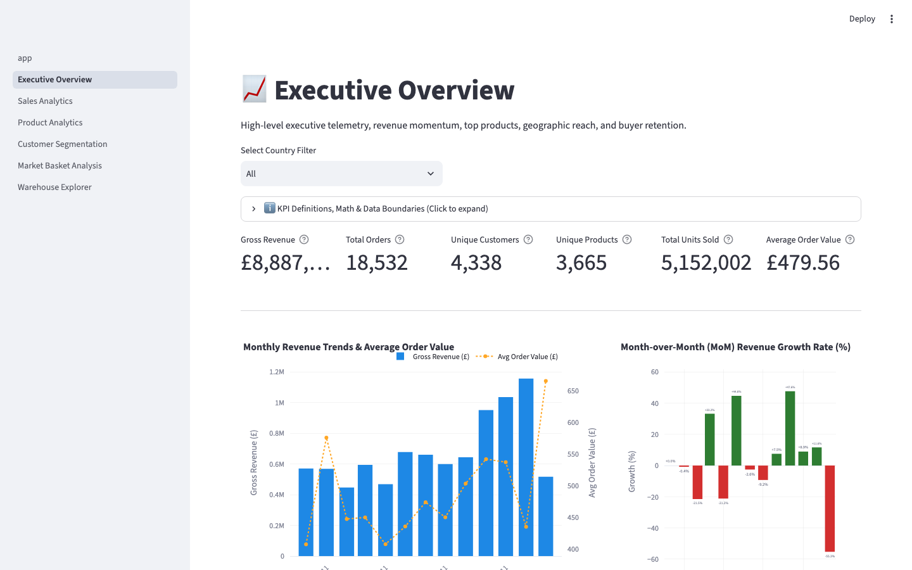
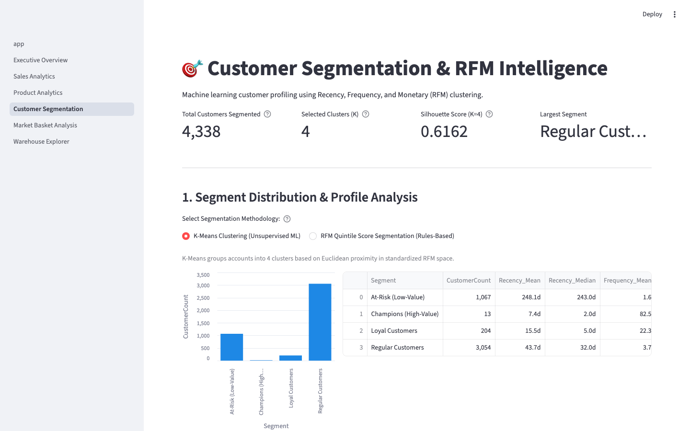
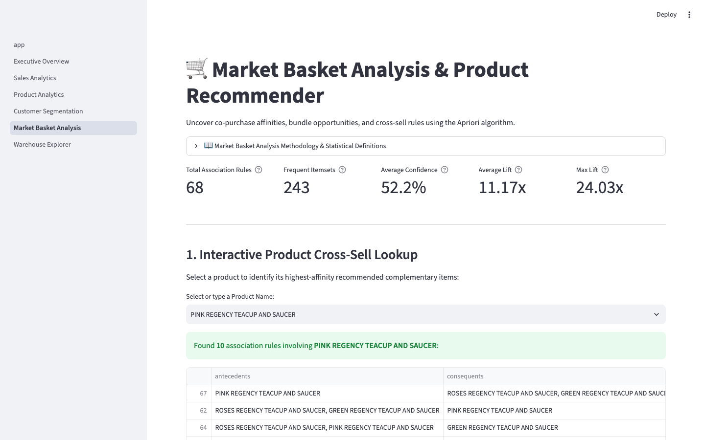
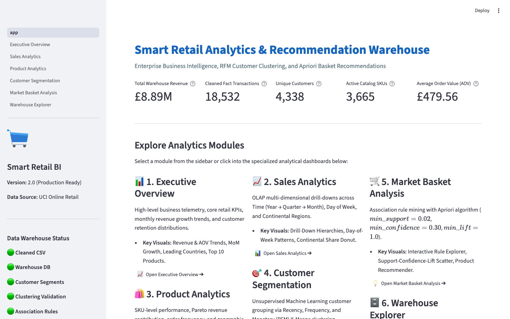

# Smart Retail Analytics & Recommendation Warehouse

> **Enterprise-Grade E-Commerce Intelligence, Star Schema Data Warehousing, RFM Customer Clustering, and Apriori Basket Recommendations**

[](https://github.com/priyanshuranjan02/Smart-Retail-And-Recommendation-System/actions/workflows/ci.yml)
[](https://www.python.org/)
[](warehouse_schema.sql)
[](dashboard/app.py)
[](README.md)

---

## 1. Problem Statement

Modern e-commerce platforms process millions of transactional line items across heterogeneous touchpoints. Small-to-medium retail enterprises frequently struggle to translate granular transaction logs into structured business intelligence due to three core bottlenecks:
1. **Unstructured & Dirty Transaction Logs:** Raw transactional data contains cancellations, zero/negative pricing, credit adjustments, and missing identifiers that distort revenue and customer accounting.
2. **Lack of Dimensional Modeling:** Querying operational databases directly for historical trends results in high query latency, complex joins, and inability to execute fast OLAP operations (slice, dice, roll-up, drill-down).
3. **Absence of Actionable Customer & Catalog Intelligence:** Without automated customer segmentation (RFM) and affinity mining (Market Basket Analysis), marketing campaigns remain undifferentiated, missing high-margin cross-sell and retention opportunities.

This project implements an end-to-end, production-grade **Smart Retail Analytics & Recommendation Warehouse** using the UCI Online Retail dataset (~541,000 raw transactions from a UK-based e-commerce platform).

---

## 2. Key Capabilities

- **Automated Data Quality & ETL Pipeline:** Robust cleaning, cancellation isolation (`C` invoice prefix), outlier filtering, and total spend calculation.
- **Star Schema Data Warehouse:** SQLite-backed relational warehouse with four dimension tables (`Dim_Time`, `Dim_Customer`, `Dim_Product`, `Dim_Region`) and a granular line-item fact table (`Fact_Sales`) with indexed surrogate foreign keys.
- **15+ OLAP Analytical SQL Queries:** Parametric BI queries covering multi-level drill-downs (Year → Quarter → Month), daily roll-ups, geographic slice-and-dice, and retention ratios.
- **Customer Segmentation (RFM + K-Means):** Unsupervised clustering on standardized Recency, Frequency, and Monetary metrics with Elbow/Silhouette evaluation and deterministic multi-attribute business labeling.
- **Complementary RFM Quintile Scoring:** 1–5 score-based tiering (Champions, Potential Loyalists, Needs Attention, At-Risk) offering rules-based comparisons against machine learning clusters.
- **Market Basket Analysis (Apriori):** Association rule generation calculating Support, Confidence, and Lift metrics to power data-driven cross-selling and product bundling hypotheses.
- **Automated Testing & CI:** Comprehensive unit test suite (48 passing tests) and GitHub Actions CI workflow covering Python 3.10, 3.11, and 3.12. Locally verified on Python 3.14.

---

## 3. Architecture & Data Workflow

```
┌─────────────────────────────────────────────────────────────────────────┐
│                       UCI Online Retail Dataset                         │
│                  (541,909 Raw Records, Dec 2010 – Dec 2011)             │
└────────────────────────────────────┬────────────────────────────────────┘
                                     │
                                     ▼
┌─────────────────────────────────────────────────────────────────────────┐
│                     1. Data Cleaning ETL Pipeline                       │
│  - Filters Cancellations ('C' prefix) & Non-positive Quantities (<= 0)  │
│  - Filters Zero/Negative Unit Prices (<= 0) & Missing Customer IDs      │
│  - Drops Duplicates & Computes TotalAmount = round(Qty * UnitPrice, 2)  │
│                   Cleaned Output: 392,692 Line Items                    │
└────────────────────────────────────┬────────────────────────────────────┘
                                     │
                                     ▼
┌─────────────────────────────────────────────────────────────────────────┐
│                  2. Star Schema Retail Data Warehouse                   │
│                                                                         │
│    ┌──────────────┐      ┌──────────────┐      ┌──────────────┐         │
│    │   Dim_Time   │      │ Dim_Customer │      │ Dim_Product  │         │
│    │   305 rows   │      │  4,338 rows  │      │  3,665 rows  │         │
│    └──────┬───────┘      └──────┬───────┘      └──────┬───────┘         │
│           │                     │                     │                 │
│           └──────────────┬──────┴─────────────────────┘                 │
│                          ▼                                              │
│                  ┌──────────────┐                                       │
│                  │  Fact_Sales  │ ◄────── ┌──────────────┐              │
│                  │ 392,692 rows │         │  Dim_Region  │              │
│                  └──────────────┘         │   37 rows    │              │
│                                           └──────────────┘              │
└──────────────────┬─────────────────────────────────┬────────────────────┘
                   │                                 │
                   ▼                                 ▼
┌────────────────────────────────────┐   ┌────────────────────────────────┐
│    3. Customer Intelligence        │   │  4. Market Basket Analysis     │
│ - RFM Feature Extraction           │   │ - Transaction Baskets (18,532) │
│ - StandardScaler Normalization     │   │ - Apriori Algorithm            │
│ - K-Means Clustering (K=4, Sil=0.62│   │ - Support >= 0.02 (243 itemsets│
│ - Defensible Multi-Metric Labels   │   │ - Confidence >= 0.30, Lift>=1.0│
│ - Complementary RFM 1-5 Scores     │   │ - 68 Association Rules         │
└──────────────────┬─────────────────┘   └────────────────┬───────────────┘
                   │                                      │
                   └──────────────────┬───────────────────┘
                                      │
                                      ▼
┌─────────────────────────────────────────────────────────────────────────┐
│        5. Interactive Streamlit Business Intelligence Application       │
│  ├── Executive Overview    ├── Product Analytics   ├── Market Basket    │
│  ├── Sales OLAP Analytics  ├── Customer Clusters   └── Warehouse SQL    │
└─────────────────────────────────────────────────────────────────────────┘
```

---

## 4. Technology Stack

| Layer | Technologies | Purpose |
|---|---|---|
| **Language** | Python 3.10+ (CI: 3.10–3.12, locally tested up to 3.14) | Core application, ETL, and ML pipelines |
| **Data Processing** | Pandas, NumPy, OpenPyXL | Vectorized data transformations and Excel ingestion |
| **Data Warehouse** | SQLite 3, Star Schema DDL | ACID-compliant dimensional data storage with foreign keys |
| **Machine Learning** | Scikit-Learn, SciPy | K-Means clustering, StandardScaler, Silhouette analysis |
| **Basket Analysis** | mlxtend | TransactionEncoder, Apriori frequent itemsets & rules |
| **Interactive UI** | Streamlit, Plotly Express/Graph Objects | Multi-page BI dashboards and interactive visualizations |
| **Testing & CI** | Pytest, GitHub Actions | Continuous integration, unit and regression tests |

---

## 5. Repository Structure

```text
Smart-Retail-And-Recommendation-System/
├── .github/
│   └── workflows/
│       └── ci.yml                     # GitHub Actions CI workflow (Python 3.10-3.12)
├── .streamlit/
│   └── config.toml                    # Streamlit server and telemetry configuration
├── dashboard/
│   ├── app.py                         # Main Streamlit portal & system status
│   ├── pages/
│   │   ├── 1_Executive_Overview.py    # Executive KPIs, monthly trends, buyer retention
│   │   ├── 2_Sales_Analytics.py       # OLAP temporal drill-downs & regional share
│   │   ├── 3_Product_Analytics.py     # SKU rankings, volume vs price, catalog search
│   │   ├── 4_Customer_Segmentation.py # K-Means vs RFM scores, 2D/3D scatter spaces
│   │   ├── 5_Market_Basket_Analysis.py# Apriori rules explorer & product recommender
│   │   └── 6_Warehouse_Explorer.py    # Schema specs, live counts & safe SQL console
│   └── components/
│       ├── data_loader.py             # Cached, thread-safe data loaders
│       ├── charts.py                  # Standardized Plotly chart builders
│       ├── metrics.py                 # KPI card renderers and formatters
│       └── insights.py                # Business interpretations & playbooks
├── data/
│   ├── cleaned/
│   │   └── online_retail_cleaned.csv  # 392,692 cleaned transaction rows
│   └── processed/
│       ├── retail_warehouse.db        # SQLite dimensional database (~47.5 MB)
│       ├── customer_segments.csv      # Customer-level RFM metrics & cluster labels
│       ├── clustering_validation.json # Inertia, silhouette scores, and profiles
│       ├── association_rules.csv      # 68 Apriori association rules
│       ├── frequent_itemsets.csv      # 243 frequent itemsets
│       ├── mba_summary.json           # MBA thresholds and metadata
│       ├── segmentation_results.txt   # Text summary of customer clusters
│       └── mba_results.txt            # Top rules ranked by confidence & lift
├── reports/
│   └── figures/
│       ├── elbow_silhouette.png       # Elbow and silhouette progression plot
│       ├── rfm_boxplots.png           # RFM distributions by cluster
│       ├── segment_distribution.png   # K-Means vs RFM score distributions
│       └── screenshots/               # High-res dashboard captures
├── tests/
│   ├── conftest.py                    # Synthetic fixtures & in-memory warehouse
│   ├── test_data_cleaning.py          # ETL transformations & validation tests
│   ├── test_warehouse.py              # Dimension builders & foreign key tests
│   ├── test_bi_queries.py             # Analytical queries & safe SQL runner tests
│   ├── test_customer_segmentation.py  # RFM math, defensible labels & score tests
│   ├── test_market_basket_analysis.py # Apriori baskets & rule filtering tests
│   └── test_dashboard_loaders.py      # Streamlit loader & artifact integrity tests
├── build_warehouse.py                 # Star schema warehouse ETL script
├── customer_segmentation.py           # RFM clustering & evaluation script
├── data_cleaning.py                   # Data cleaning pipeline script
├── bi_queries.py                      # 15+ OLAP analytical SQL queries
├── market_basket_analysis.py          # Apriori association rule mining script
├── run_pipeline.py                    # End-to-end orchestration runner
├── warehouse_schema.sql               # Star schema DDL & index creation
├── pytest.ini                         # Pytest configuration
├── requirements.txt                   # Production dependencies
└── README.md                          # Comprehensive project documentation
```

---

## 6. Dataset Source & Attributes

- **Origin:** [UCI Machine Learning Repository: Online Retail Dataset](https://archive.ics.uci.edu/ml/datasets/Online+Retail)
- **Timeframe:** 01/12/2010 to 09/12/2011 (1 year 8 days)
- **Retailer Profile:** Non-store online retailer based in the UK, specializing in unique all-occasion gift-ware. Many customers are wholesale accounts.
- **Raw Volume:** 541,909 transaction records.

| Attribute | Data Type | Description | Cleaning Treatment |
|---|---|---|---|
| `InvoiceNo` | String / Object | 6-digit invoice number | Records prefixed with 'C' (cancellations) are dropped. |
| `StockCode` | String / Object | 5-digit product code | Validated across line items; mapped to `Dim_Product`. |
| `Description` | String / Object | Product item name | Trimmed; modal description selected per StockCode. |
| `Quantity` | Integer | Units per transaction | Rows with `Quantity <= 0` dropped. |
| `InvoiceDate` | Datetime | Transaction timestamp | Parsed to datetime; split into calendar date and time. |
| `UnitPrice` | Float | Unit price in GBP (£) | Rows with `UnitPrice <= 0` dropped. |
| `CustomerID` | Float / Integer | 5-digit customer ID | Nulls dropped (unidentifiable buyers); cast to int. |
| `Country` | String / Object | Country of buyer | Cleaned and mapped to continental regions in `Dim_Region`. |

---

## 7. Installation Instructions

### Prerequisites
- Python 3.10, 3.11, or 3.12 installed (also locally verified on 3.14).
- Git.

### Step 1: Clone the Repository
```bash
git clone https://github.com/priyanshuranjan02/Smart-Retail-And-Recommendation-System.git
cd Smart-Retail-And-Recommendation-System
```

### Step 2: Create and Activate a Virtual Environment
```bash
# On macOS / Linux
python3 -m venv venv
source venv/bin/activate

# On Windows
python -m venv venv
venv\Scripts\activate
```

### Step 3: Install Required Dependencies
```bash
pip install --upgrade pip
pip install -r requirements.txt
```

---

## 8. Pipeline Execution Instructions

The project provides both a single automated orchestrator (`run_pipeline.py`) and standalone scripts for individual modules.

### Option A: End-to-End Execution (Recommended)
Run all 5 pipeline stages in correct dependency order:
```bash
# Run full pipeline (clean, build warehouse, verify BI, segment customers, mine rules)
python run_pipeline.py

# Re-run warehouse construction and analytics while reusing cleaned CSV:
python run_pipeline.py --skip-clean
```

### Option B: Standalone Script Execution
```bash
# 1. Clean the raw dataset (downloads from UCI if raw file is missing)
python data_cleaning.py

# 2. Build the star schema database (creates safety backup if DB exists)
python build_warehouse.py

# 3. Execute and verify the 15+ analytical BI queries
python bi_queries.py

# 4. Perform RFM customer segmentation and K-Means validation
python customer_segmentation.py

# 5. Mine frequent itemsets and generate association rules
python market_basket_analysis.py
```

---

## 9. Launching the Interactive BI Dashboard

### Local Execution
Launch the Streamlit multi-page application with a single command:
```bash
streamlit run dashboard/app.py
```
Open your browser to `http://localhost:8501`.

### Streamlit Community Cloud Deployment
The repository is fully configured for zero-friction one-click deployment on [Streamlit Community Cloud](https://share.streamlit.io/):

1. **Repository:** Select `priyanshuranjan02/Smart-Retail-And-Recommendation-System`
2. **Branch:** `main` (or your feature branch)
3. **Main file path:** `dashboard/app.py`
4. **Python version:** 3.10, 3.11, or 3.12
5. **App dependencies:** Automatically resolved from root `requirements.txt`.
6. **Zero-Config Cloud Warehouse Initialization:**
   - On the cloud instance, `retail_warehouse.db` is initialized automatically on first startup via `ensure_warehouse_database()` in `dashboard/components/data_loader.py`.
   - It builds directly from the tracked `data/cleaned/online_retail_cleaned.csv` and `warehouse_schema.sql` in seconds using atomic replacement and thread-safe locking.
   - All analytical CSV/JSON artifacts (`customer_segments.csv`, `association_rules.csv`, `mba_summary.json`, etc.) are tracked directly in Git, allowing instant cloud readiness without downloading the raw source dataset or retraining models.

---

## 10. Warehouse Schema Overview

The relational data warehouse implements a classic **Star Schema** optimized for analytical queries:

```
                    ┌──────────────┐
                    │   Dim_Time   │
                    │   305 rows   │
                    └──────┬───────┘
                           │
       ┌──────────────┐    │    ┌──────────────┐
       │ Dim_Customer ├────┼────┤ Dim_Product  │
       │  4,338 rows  │    │    │  3,665 rows  │
       └──────────────┘    │    └──────────────┘
                           │
                    ┌──────┴───────┐
                    │  Fact_Sales  │
                    │ 392,692 rows │
                    └──────┬───────┘
                           │
                    ┌──────┴───────┐
                    │  Dim_Region  │
                    │   37 rows    │
                    └──────────────┘
```

### Table Definitions
1. **`Dim_Time` (Grain: 1 row per unique calendar date):**
   - Keys: `TimeKey` (PK, integer surrogate YYYYMMDD), `FullDate` (DATE).
   - Attributes: `Year`, `Quarter`, `Month`, `MonthName`, `Week`, `DayOfMonth`, `DayOfWeek`, `DayName`, `IsWeekend`.
2. **`Dim_Customer` (Grain: 1 row per unique CustomerID):**
   - Keys: `CustomerKey` (PK, surrogate), `CustomerID` (natural key, integer).
   - Attributes: `FirstPurchase`, `LastPurchase`, `TotalOrders`, `TotalSpend`, `Country`.
3. **`Dim_Product` (Grain: 1 row per unique StockCode):**
   - Keys: `ProductKey` (PK, surrogate), `StockCode` (natural key, text).
   - Attributes: `Description`, `AvgUnitPrice`, `TimesOrdered`.
4. **`Dim_Region` (Grain: 1 row per unique Country):**
   - Keys: `RegionKey` (PK, surrogate), `Country` (natural key, text).
   - Attributes: `Region` (Europe, North America, Asia, etc.).
5. **`Fact_Sales` (Grain: 1 row per invoice line item):**
   - Foreign Keys: `TimeKey`, `CustomerKey`, `ProductKey`, `RegionKey` with indexes.
   - Degenerate Dimension: `InvoiceNo`, `InvoiceTime`.
   - Measures: `Quantity`, `UnitPrice`, `TotalAmount` (GBP £).

---

## 11. Customer Segmentation Methodology

### Feature Engineering
For each customer, three behavioral dimensions are computed from transaction history:
- **Recency ($R$):** Days elapsed between the customer's most recent transaction and the reference date (one day after dataset maximum: `2011-12-10`). Fewer days indicates higher engagement.
- **Frequency ($F$):** Total count of unique checkout transactions (`InvoiceNo`).
- **Monetary ($M$):** Cumulative spending across all purchases in GBP (£).

Features are standardized using `StandardScaler` to ensure unit-variance scale parity prior to Euclidean distance calculations.

### Defensible Cluster Labeling Rule
Cluster numbers assigned by K-Means are arbitrary. To ensure labeling is deterministic, transparent, and grounded in behavior, the system evaluates composite ranks across all three dimensions (using both Mean and Median to account for heavy-tailed spend skew):
$$\text{Composite Rank} = \text{Rank}(R_{\text{ascending}}) + \text{Rank}(F_{\text{descending}}) + \text{Rank}(M_{\text{descending}})$$

| Segment Name | Count | Pop. % | Recency (Mean / Median) | Frequency (Mean / Median) | Monetary (Mean / Median) | Behavior Profile |
|---|---|---|---|---|---|---|
| **Champions (High-Value)** | 13 | 0.3% | 7.4d / 2.0d | 82.5 / 63.0 orders | £127,187.96 / £117,210.08 | High-volume B2B wholesale buyers; weekly reorders |
| **Loyal Customers** | 204 | 4.7% | 15.5d / 5.0d | 22.3 / 18.0 orders | £12,690.50 / £7,990.21 | Regular high-spend repeat buyers |
| **Regular Customers** | 3,054 | 70.4% | 43.7d / 32.0d | 3.7 / 3.0 orders | £1,353.63 / £826.27 | Active retail shoppers with moderate frequency |
| **At-Risk (Low-Value)** | 1,067 | 24.6% | 248.1d / 243.0d | 1.6 / 1.0 orders | £478.85 / £310.26 | Lapsed customers inactive for >8 months |

---

## 12. Cluster Validation & Selected K Rationale

### Quantitative Evaluation
Candidate cluster solutions were tested for $K \in [2, 8]$ using Euclidean inertia (Within-Cluster Sum of Squares) and the Silhouette Coefficient:

| K | Inertia | Silhouette Score | Business Assessment |
|---|---|---|---|
| **2** | 9,014.57 | **0.8958** | **Rejected:** Isolates 26 extreme outliers from 4,312 customers (99.4%). Zero marketing utility. |
| **3** | 5,441.32 | 0.5942 | Suboptimal separation between active and dormant buyers. |
| **4** | 4,096.30 | **0.6162** | **Selected:** Optimal balance of high silhouette score and actionable retail tiers. |
| **5** | 3,119.79 | 0.6165 | Marginal gain; splinters regular customers into redundant sub-tiers. |
| **6** | 2,473.79 | 0.5983 | Diminishing returns; over-segments small cohorts. |
| **7** | 2,023.59 | 0.5165 | Decreasing cluster stability. |
| **8** | 1,717.01 | 0.4859 | High cluster fragmentation. |

### Why K=4 was Chosen Over K=2
In academic clustering benchmarks, automated algorithms select $K=2$ because separating 26 extreme spenders produces a very high silhouette score ($0.8958$). However, from a retail operations perspective, lumping active regular shoppers and dormant 8-month churned buyers into a single 4,312-customer cluster makes marketing differentiation impossible. $K=4$ preserves a strong silhouette coefficient ($0.6162$) while cleanly distinguishing VIP B2B champions, loyal recurring accounts, active consumers, and churned customers.

---

## 13. Market Basket Analysis Methodology & Thresholds

Frequent itemsets and association rules were mined using the **Apriori algorithm** across all 18,532 transaction baskets:

- **Minimum Support Threshold:** $0.02$ (2.0%). An itemset must appear in at least 370 separate transactions to be considered frequent. This filters out niche catalog noise while preserving high-volume affinities.
- **Itemset Length Limit:** Maximum length of 3 items (`max_len=3`) for optimal business interpretability.
- **Minimum Lift Threshold:** $1.0$ (enforced during rule generation to ensure pairs co-occur more frequently than independent probability).
- **Minimum Confidence Threshold:** $0.30$ (30.0% post-filtering to select highly predictive rules).

### Key Metrics Defined
- **Support ($P(A \cap B)$):** Percentage of total checkout baskets containing both items.
- **Confidence ($P(B|A) = \frac{P(A \cap B)}{P(A)}$):** Likelihood that product $B$ is purchased when product $A$ is in the basket.
- **Lift ($\frac{P(B|A)}{P(B)}$):** Factor by which co-occurrence exceeds expected independence. Lift > 1 indicates true complementary affinity.

### Real Example from Generated Rules
- **Rule:** `[PINK REGENCY TEACUP AND SAUCER, ROSES REGENCY TEACUP AND SAUCER] -> [GREEN REGENCY TEACUP AND SAUCER]`
- **Support:** $2.10\%$ ($389$ transactions).
- **Confidence:** $89.45\%$ (89.5% of customers buying pink and rose teacups also purchase the green teacup).
- **Lift:** $23.99\times$ (Purchased together nearly 24 times more frequently than chance).
- **Actionable Insight:** Perfect bundle recommendation for gift-ware sets.

---

## 14. Verified Warehouse & Analytics Results

All figures below are validated from the actual warehouse and pipeline execution:

| Metric Category | Verified Output Value |
|---|---|
| **Cleaned Fact Rows** | 392,692 |
| **Gross Warehouse Revenue** | £8,887,208.89 |
| **Total Orders (Distinct Invoices)** | 18,532 |
| **Unique Customers Identified** | 4,338 |
| **Catalog Products (SKUs)** | 3,665 |
| **Total Units Sold** | 5,152,002 |
| **Average Order Value (AOV)** | £479.56 |
| **Average Order Line Value** | £22.63 |
| **Top Country by Revenue** | United Kingdom (£7,285,024.64, 81.97% share) |
| **Top Continental Region** | Europe (£8,666,499.65, 97.52% share) |
| **Peak Sales Day** | Thursday (£1,973,015.73 across 4,032 orders) |
| **Frequent Itemsets Found** | 243 |
| **Association Rules Generated** | 68 |
| **Average Rule Confidence** | 52.20% |
| **Average Rule Lift** | 11.17× (Max Lift: 24.03×) |

> ### 💡 Core Metric Distinctions & Grain Definitions
> - **Fact-Table Line Items (`Fact_Sales`: 392,692 rows):** The lowest analytical grain in the warehouse. Represents individual SKU purchase events within an order (e.g., an invoice with 5 different products generates 5 fact rows).
> - **Unique Orders / Invoices (`18,532`):** Total distinct checkout carts (`COUNT(DISTINCT InvoiceNo)`). Multiple line-item rows belong to a single order.
> - **Unique Customers (`4,338`):** Distinct identified buyer accounts (`COUNT(DISTINCT CustomerID)`). A single customer places multiple orders over time.
> - **Average Order Value (AOV = £479.56):** Calculated strictly as $\frac{\text{Gross Revenue}}{\text{Total Orders}} = \frac{£8,887,208.89}{18,532}$. Reflects mean total spend per checkout transaction.
> - **Average Line Item Value (£22.63):** Calculated as $\frac{\text{Gross Revenue}}{\text{Fact Rows}} = \frac{£8,887,208.89}{392,692}$. Distinguishes individual item-level charges from basket-level spend.

---

## 15. Practical Business Recommendations

| Customer Segment | Business Objective | Recommended Strategy | Suggested Monitoring KPI |
|---|---|---|---|
| **Champions (High-Value)** | Retain & Protect | Assign dedicated B2B wholesale account managers; offer negotiated volume tier pricing; priority fulfillment. | B2B retention rate, Order frequency stability |
| **Loyal Customers** | Cultivate LTV & Cross-Sell | Launch exclusive VIP loyalty tier; early-access seasonal gifting previews; automated product bundles. | Average Order Value (AOV), Repeat purchase rate |
| **Regular Customers** | Nurture & Upsell | Implement post-purchase automated email triggers; free-shipping basket thresholds (£50+); category cross-sells. | Second-order conversion rate, Purchase frequency |
| **At-Risk (Low-Value)** | Win-Back or Deprioritize | Targeted "We Miss You" reactivation campaign with time-bound discount; exit feedback survey. | Reactivation rate, Re-acquisition ROI |

---

## 16. Dashboard Visualizations & Screenshots

High-resolution captures from the running Streamlit BI application:

### Executive Overview


### Customer Segmentation & RFM Intelligence


### Market Basket Analysis & Product Recommender


### Portal Landing & Health Status


---

## 17. Automated Testing & Verification

The test suite covers data cleaning, dimensional transformations, foreign key constraints, BI SQL queries, RFM math, cluster labeling, Apriori rule mining, and dashboard loaders.

### Running Tests Locally
```bash
# Run full automated test suite with verbose output
pytest -v

# Run with test coverage report
pytest --cov=. --cov-report=term-missing
```

### Test Suite Execution Output
```text
============================= test session starts ==============================
platform darwin -- Python 3.14.6, pytest-9.1.1, pluggy-1.7.0
rootdir: /Users/.../Smart Retail And Recommendation System
configfile: pytest.ini
testpaths: tests

tests/test_bi_queries.py::test_get_kpis_accuracy PASSED                  [  2%]
tests/test_bi_queries.py::test_get_kpis_with_country_filter PASSED       [  4%]
tests/test_bi_queries.py::test_get_monthly_sales PASSED                  [  6%]
tests/test_bi_queries.py::test_get_top_products PASSED                   [  8%]
tests/test_bi_queries.py::test_execute_safe_query_select_allowed PASSED  [ 10%]
tests/test_bi_queries.py::test_execute_safe_query_blocks_destructive_ddl PASSED [ 12%]
tests/test_bi_queries.py::test_execute_safe_query_blocks_insert PASSED   [ 14%]
tests/test_bi_queries.py::test_execute_safe_query_blocks_update PASSED   [ 16%]
tests/test_bi_queries.py::test_execute_safe_query_blocks_embedded_drop PASSED [ 18%]
tests/test_bi_queries.py::test_execute_safe_query_blocks_empty PASSED    [ 20%]
tests/test_customer_segmentation.py::test_calculate_rfm PASSED           [ 22%]
tests/test_customer_segmentation.py::test_calculate_rfm_scores PASSED    [ 25%]
tests/test_customer_segmentation.py::test_assign_defensible_cluster_labels PASSED [ 27%]
tests/test_dashboard_loaders.py::test_get_db_connection_missing_raises PASSED [ 29%]
tests/test_dashboard_loaders.py::test_ensure_warehouse_database_creates_missing PASSED [ 31%]
tests/test_dashboard_loaders.py::test_ensure_warehouse_database_reuses_existing PASSED [ 33%]
tests/test_dashboard_loaders.py::test_ensure_warehouse_database_failed_build_cleans_up PASSED [ 35%]
tests/test_dashboard_loaders.py::test_ensure_warehouse_database_missing_prerequisites_raises PASSED [ 37%]
tests/test_dashboard_loaders.py::test_check_artifact_status PASSED       [ 39%]
tests/test_dashboard_loaders.py::test_load_countries_list PASSED         [ 41%]
tests/test_dashboard_loaders.py::test_load_kpis_live PASSED              [ 43%]
tests/test_dashboard_loaders.py::test_load_customer_segments_live PASSED [ 45%]
tests/test_dashboard_loaders.py::test_load_clustering_validation_live PASSED [ 47%]
tests/test_dashboard_loaders.py::test_load_association_rules_live PASSED [ 50%]
tests/test_dashboard_loaders.py::test_load_warehouse_tables_live PASSED  [ 52%]
tests/test_data_cleaning.py::test_clean_dataset_removes_cancellations PASSED [ 54%]
tests/test_data_cleaning.py::test_clean_dataset_removes_negative_and_zero_quantities PASSED [ 56%]
tests/test_data_cleaning.py::test_clean_dataset_removes_invalid_unit_prices PASSED [ 58%]
tests/test_data_cleaning.py::test_clean_dataset_removes_missing_customer_ids PASSED [ 60%]
tests/test_data_cleaning.py::test_clean_dataset_deduplication PASSED     [ 62%]
tests/test_data_cleaning.py::test_clean_dataset_total_amount_calculation PASSED [ 64%]
tests/test_data_cleaning.py::test_acquire_raw_dataset_existing_file PASSED [ 66%]
tests/test_data_cleaning.py::test_acquire_raw_dataset_successful_download PASSED [ 68%]
tests/test_data_cleaning.py::test_acquire_raw_dataset_ssl_verification_failure PASSED [ 70%]
tests/test_data_cleaning.py::test_acquire_raw_dataset_url_error_with_ssl_reason PASSED [ 72%]
tests/test_data_cleaning.py::test_acquire_raw_dataset_interrupted_download_cleans_temp_file PASSED [ 75%]
tests/test_data_cleaning.py::test_acquire_raw_dataset_general_network_failure PASSED [ 77%]
tests/test_data_cleaning.py::test_acquire_raw_dataset_rejects_non_https_url PASSED [ 79%]
tests/test_market_basket_analysis.py::test_format_itemset_canonical PASSED [ 81%]
tests/test_market_basket_analysis.py::test_build_transaction_baskets PASSED [ 83%]
tests/test_market_basket_analysis.py::test_find_frequent_itemsets PASSED [ 85%]
tests/test_market_basket_analysis.py::test_generate_rules PASSED         [ 87%]
tests/test_market_basket_analysis.py::test_mba_outputs_byte_identical_reproducibility PASSED [ 89%]
tests/test_warehouse.py::test_dim_time_generation PASSED                 [ 91%]
tests/test_warehouse.py::test_dim_region_mapping PASSED                  [ 93%]
tests/test_warehouse.py::test_dim_product_aggregation PASSED             [ 95%]
tests/test_warehouse.py::test_dim_customer_aggregation PASSED            [ 97%]
tests/test_warehouse.py::test_warehouse_fact_and_foreign_key_integrity PASSED [100%]

============================== 48 passed in 1.36s ==============================
```

---

## 18. Known Limitations

1. **Lack of Cost Data (COGS):** The UCI Online Retail dataset provides `UnitPrice` and `Quantity`, which allows exact calculation of Gross Revenue. However, Cost of Goods Sold (COGS) is absent, meaning True Profit and Gross Margin cannot be computed without assumptions.
2. **Short Time Horizon:** The dataset spans 12 months and 8 days (Dec 2010 – Dec 2011). Because only December has two data points, multi-year seasonality cannot be fully modeled.
3. **Correlation vs Causation in Association Rules:** Market Basket Analysis rules reflect co-occurrence probability, not causal proof that purchasing item $A$ causes the acquisition of item $B$.
4. **Offline Database Architecture:** The current implementation uses an embedded SQLite database suitable for single-node analytical exploration. For multi-terabyte production scale, migration to BigQuery, Snowflake, or PostgreSQL would be required.

---

## 19. Troubleshooting Guidance

- **Missing Artifacts Warning:** If the dashboard displays a warning that `retail_warehouse.db` or `customer_segments.csv` is missing, run:
  ```bash
  python run_pipeline.py
  ```
- **Matplotlib Cache Warning (`.matplotlib is not writable`):** Set the `MPLCONFIGDIR` environment variable:
  ```bash
  export MPLCONFIGDIR=/tmp/matplotlib
  ```
- **Streamlit Port Already in Use:** If port 8501 is busy, specify an alternate port:
  ```bash
  streamlit run dashboard/app.py --server.port=8502
  ```

---

## 20. License & Academic Use

This project was developed for academic and portfolio demonstration purposes as part of a final-year engineering curriculum. Dataset rights remain with the original authors (Dr. Daqing Chen, University of Hertfordshire) and the UCI Machine Learning Repository.
